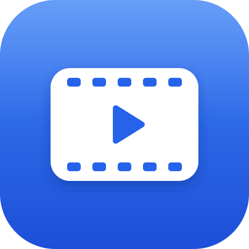
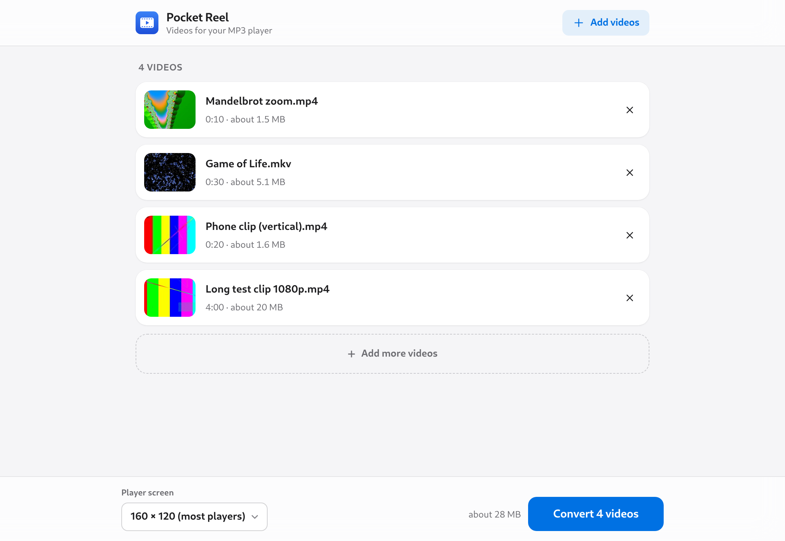
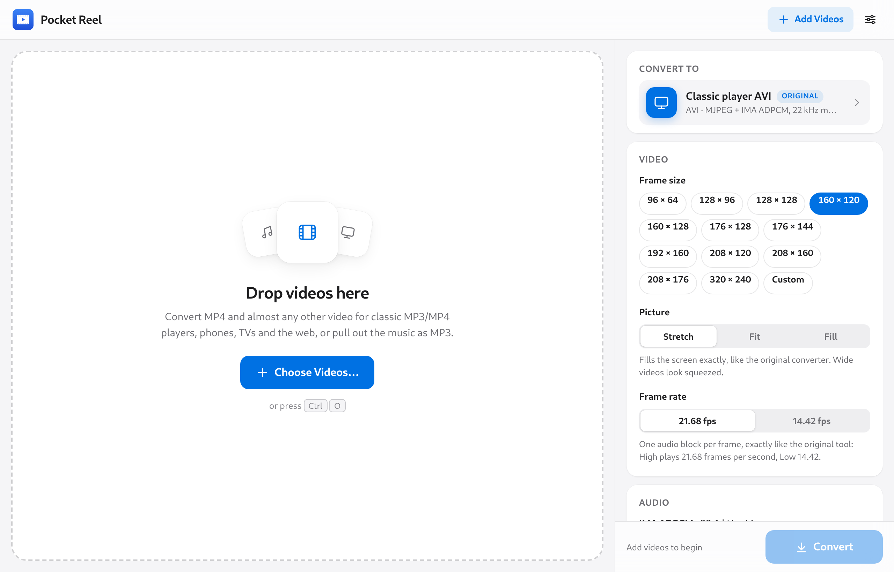
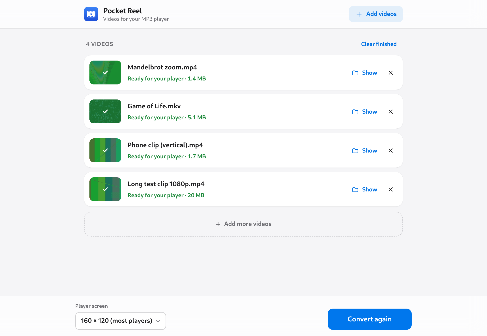
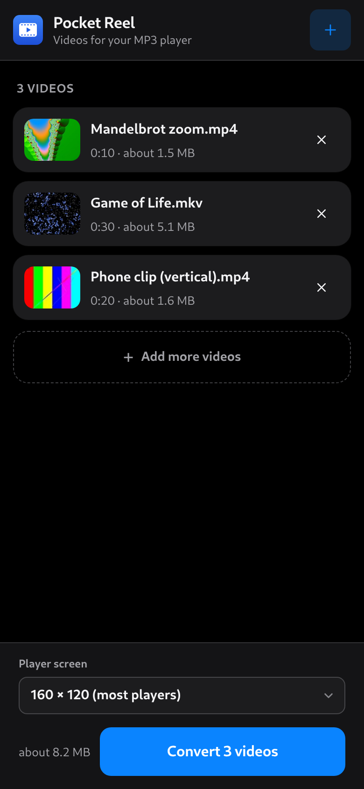
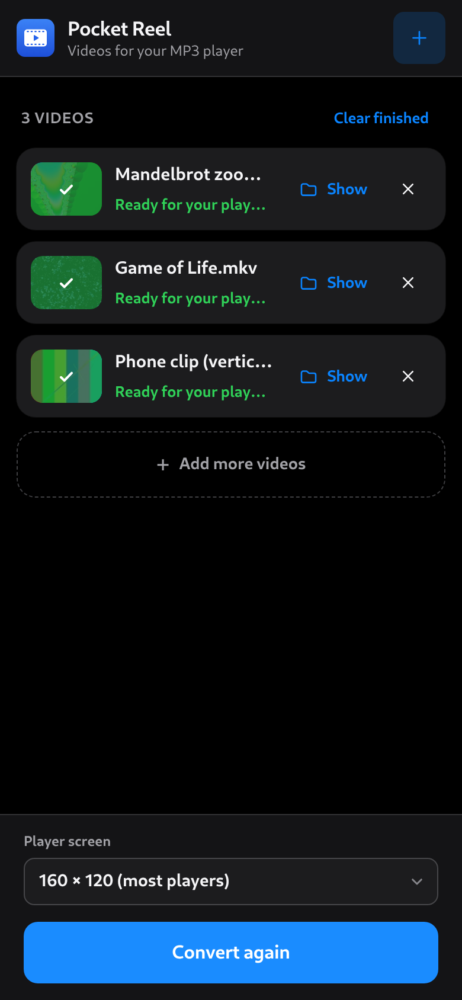

<div align="center">



# Pocket Reel

**Put any video on your MP3 player.**<br>
Add videos or paste a link, press Convert, copy them to the player. That's it.

[](https://github.com/mananbharti/pocket-reel/actions/workflows/ci.yml)
[](https://github.com/mananbharti/pocket-reel/releases/latest)
[](LICENSE)


[**Download**](https://github.com/mananbharti/pocket-reel/releases/latest) ·
[**Website**](https://mananbharti.github.io/pocket-reel/) ·
[How the original tool was reverse engineered](docs/FINDINGS.md)

<picture>
  <source media="(prefers-color-scheme: dark)" srcset="docs/screenshots/ready-dark.png">
  
</picture>

</div>

## How to use it

1. **Add videos.** Click *Choose videos*, drop them on the window, or **paste a video link**. Add as many as you like.
2. **Press Convert.** Every video is turned into the exact video format your MP3 player plays.
3. **Copy them to your player.** Plug the player in and copy the `.avi` files onto it (usually into its `VIDEO` folder).

**Links work too.** Paste a link from YouTube, Instagram, X, Facebook, Vimeo, TikTok, Reddit, Dailymotion and [1000+ other sites](https://github.com/yt-dlp/yt-dlp/blob/master/supportedsites.md), or a direct link to a video file. Pocket Reel downloads it and converts it in one go. On Android, tap *Share* in YouTube or your browser and pick **Pocket Reel**: the video is downloaded and converted on its own.

**Tip:** set *Save to* to your player's drive, and the converted videos go straight onto the player.

Most players have a 160 × 120 screen, which is the default. If yours is different, pick its size once under *Player screen*; Pocket Reel remembers it.

## Download

| Platform | File |
| --- | --- |
| **Windows 10/11** (64-bit) | [`PocketReel-windows-x64-setup.exe`](https://github.com/mananbharti/pocket-reel/releases/latest/download/PocketReel-windows-x64-setup.exe) (an `.msi` is attached too) |
| **Linux** (x86-64) | [`PocketReel-linux-x86_64.AppImage`](https://github.com/mananbharti/pocket-reel/releases/latest/download/PocketReel-linux-x86_64.AppImage) (a `.deb` is attached too) |
| **Android 8+** | [`PocketReel-android.apk`](https://github.com/mananbharti/pocket-reel/releases/latest/download/PocketReel-android.apk). Converted videos are saved to *Movies › Pocket Reel*. |

Everything is built in. Nothing to install and no account. Your own videos never leave your device; the internet is only used when you add a link.

> [!IMPORTANT]
> Only download videos you have the right to keep, such as your own, ones with a free licence, or ones the site lets you download. Respect each site's terms.

> [!NOTE]
> The Windows installer is not code-signed yet, so SmartScreen may ask you to confirm ("More info", then "Run anyway").

## Why this exists

These little MP3/MP4 players (Audiocular and many other brands built on Actions Semiconductor chips) only play one very particular kind of video. Their official converter, *Media Player Utilities 4.46*, does the job but is Windows-only, dated, and confusing.

Pocket Reel does the same job with one screen and one button. It was rebuilt from scratch after taking the official tool apart ([findings](docs/FINDINGS.md)); none of its code is reused, but **the files it writes are the same format, with byte-for-byte identical headers**, so they play on the same players.

<table>
  <tr>
    <td width="50%"></td>
    <td width="50%"></td>
  </tr>
  <tr>
    <td></td>
    <td align="center"> </td>
  </tr>
</table>

## What it does for you

- Converts **as many videos as you want** in one go, two at a time.
- Shows each video's **size before converting**, a **progress bar with time left** while converting, and **Ready for your player** when done.
- **Stop** any time; a stopped or failed video leaves no half-written file behind. *Try again* is one click.
- Reads almost any video: MP4, MKV, MOV, AVI, WebM, phone videos, screen recordings and more.
- Never overwrites your files.
- Accessible: works fully with a keyboard (<kbd>Ctrl</kbd> <kbd>O</kbd> add, <kbd>Ctrl</kbd> <kbd>Enter</kbd> convert) and screen readers, follows your system's light/dark, high-contrast and reduced-motion settings.

## The player format, exactly

The same as the official converter's default:

| | |
| --- | --- |
| Container | AVI with `idx1` index, every chunk aligned to 4 bytes |
| Video | MJPEG (`MJPG`), YCbCr 4:2:0, quality-75 tables, standard Huffman tables, `AVI1` marker in every frame |
| Audio | IMA ADPCM, 22,050 Hz, mono, one audio block per video frame |
| Frame rate | 21.68 fps (the official tool's "high" setting) |
| Screen | 160 × 120 by default; 96×64, 128×96, 128×128, 160×128, 176×128, 176×144, 192×160, 208×120, 208×160, 208×176, 320×240 |
| Player fields | frame rate × 1024 and the length as HH:MM:SS in the AVI header, as the official tool writes them |

The headers Pocket Reel writes hash identically to the templates inside the official encoder (see [`crates/engine/tests/fidelity.rs`](crates/engine/tests/fidelity.rs)).

## For developers

```bash
git clone https://github.com/mananbharti/pocket-reel && cd pocket-reel
cargo test -p pocketreel-engine          # unit, fidelity and end-to-end tests (needs FFmpeg)
cd app && npm ci && npx tauri dev        # run the app
```

- `crates/engine`: the conversion engine in Rust, including the from-scratch JPEG, IMA ADPCM and AVI writers, and link downloads through [yt-dlp](https://github.com/yt-dlp/yt-dlp).
- `crates/cli`: `pocketreel convert *.mp4 -o /media/PLAYER/VIDEO` for batch use from a terminal.
- `app`: the Svelte UI and the Tauri shell for Windows, Linux and Android.
- `.github/workflows/release.yml`: builds and tests all three platforms; Android builds are installed on an emulator, convert a real video through the app, and the result is checked.

The engine also knows more formats (MP4, MP3 and others) that the CLI can produce; the app keeps to the one job.

## License and credits

Free software under the [GNU GPL v3 or later](LICENSE). Bundles [FFmpeg](https://ffmpeg.org) (GPL build with [LAME](https://lame.sourceforge.io) and [x264](https://www.videolan.org/developers/x264.html)). Downloads links with [yt-dlp](https://github.com/yt-dlp/yt-dlp) (Unlicense) and [QuickJS](https://github.com/quickjs-ng/quickjs) (MIT) on desktop, and with [youtubedl-android](https://github.com/JunkFood02/youtubedl-android), the library behind [YTDLnis](https://github.com/deniscerri/ytdlnis), on Android. Built with [Tauri](https://tauri.app) and [Svelte](https://svelte.dev).

Not affiliated with Actions Semiconductor or Audiocular. Product names belong to their owners.
