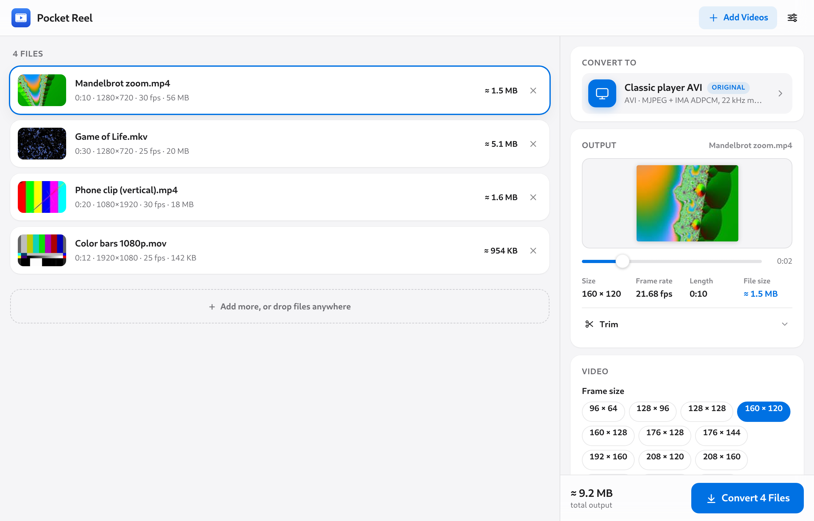
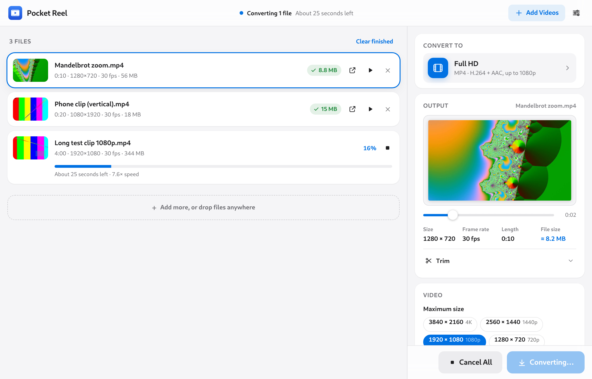
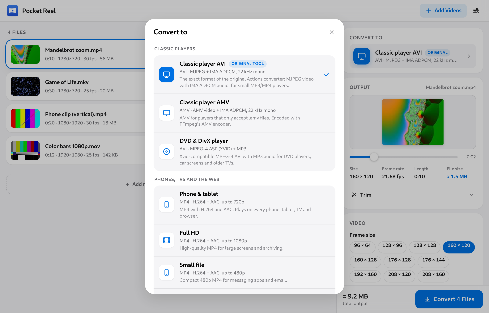
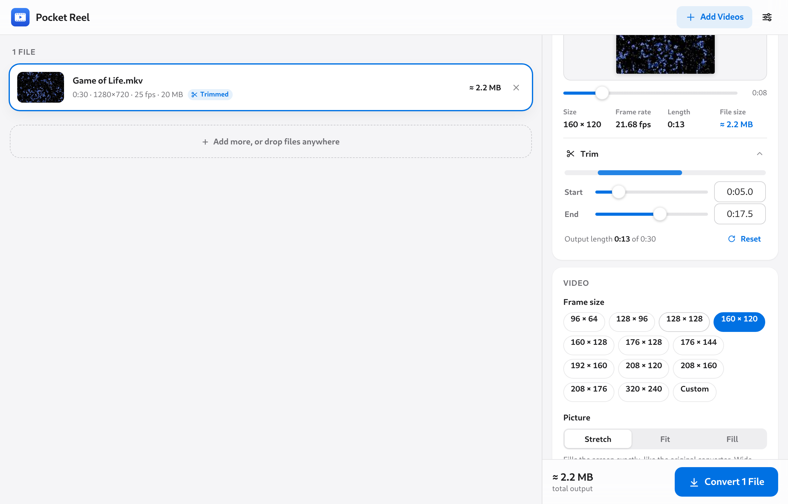
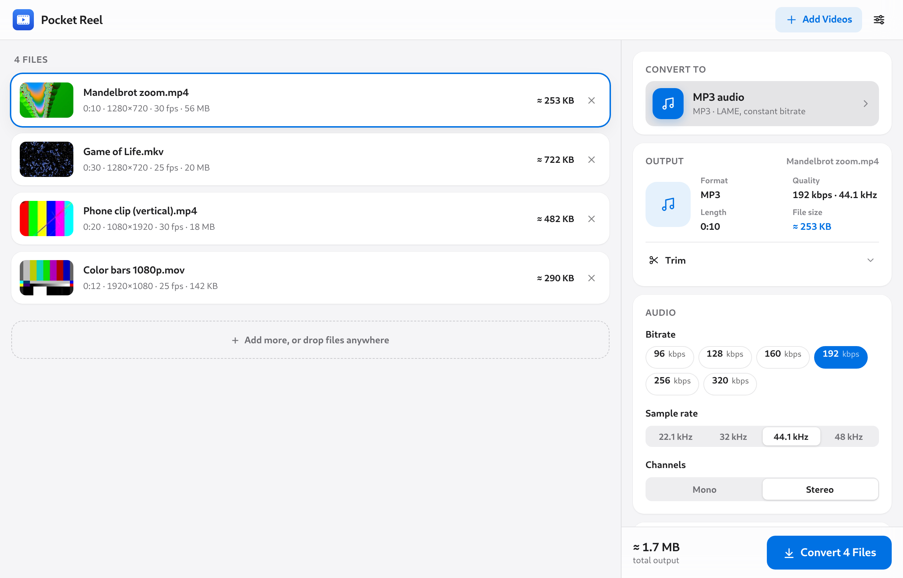
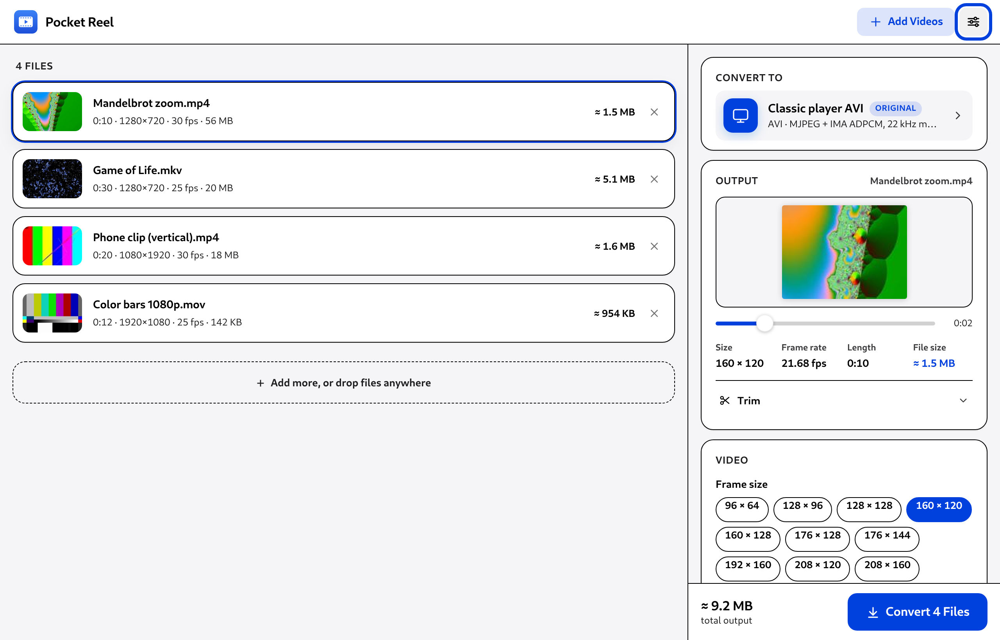
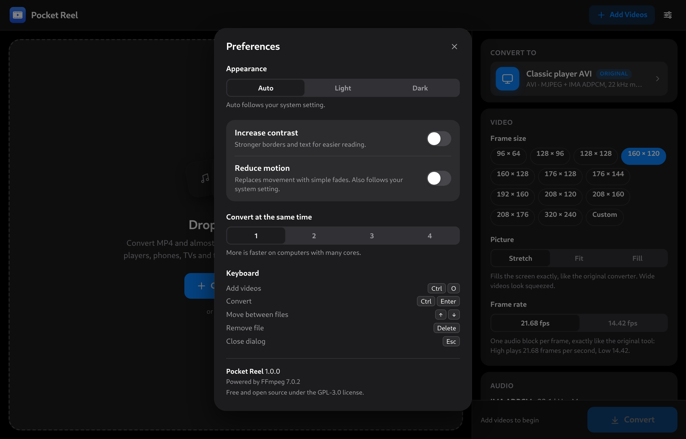
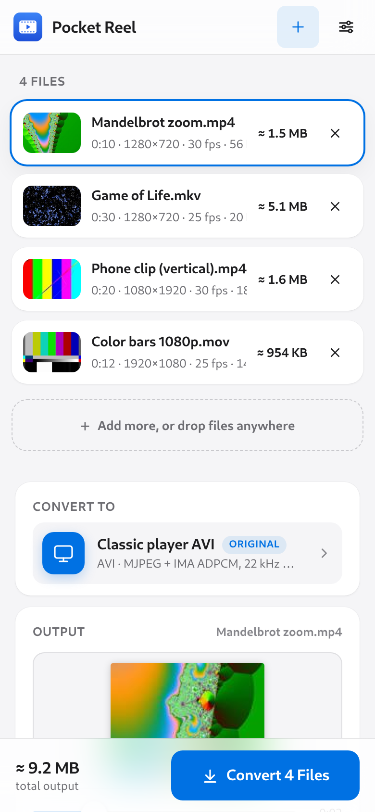
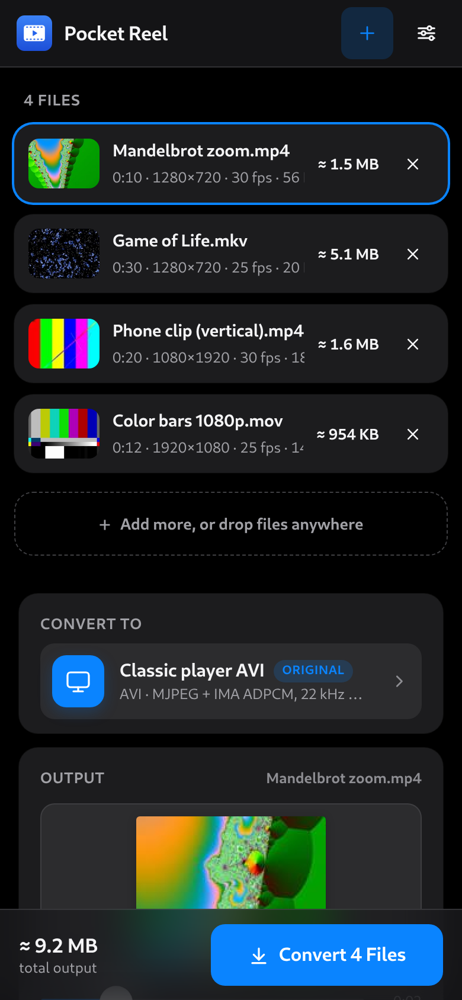
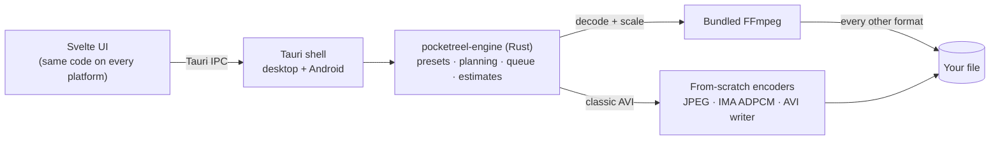

<div align="center">


# Pocket Reel

**Convert any video for any player.**<br>
MP4 to the exact AVI format small MP3/MP4 players expect, plus MP4, WebM, MP3, AAC, FLAC and WAV.<br>
Free, open source, private, and made for everyone, including people who use a screen reader or keyboard.

[](https://github.com/mananbharti/pocket-reel/actions/workflows/ci.yml)
[](https://github.com/mananbharti/pocket-reel/releases/latest)
[](LICENSE)


[**Download**](https://github.com/mananbharti/pocket-reel/releases/latest) ·
[**Website**](https://mananbharti.github.io/pocket-reel/) ·
[How it was reverse engineered](docs/FINDINGS.md)

<picture>
  <source media="(prefers-color-scheme: dark)" srcset="docs/screenshots/desktop-dark.png">
  
</picture>

</div>

## Download

| Platform | File | Notes |
| --- | --- | --- |
| **Windows 10/11** (64-bit) | [`PocketReel-windows-x64-setup.exe`](https://github.com/mananbharti/pocket-reel/releases/latest/download/PocketReel-windows-x64-setup.exe) | Per-user installer, no admin rights. An `.msi` is attached too. |
| **Linux** (x86-64) | [`PocketReel-linux-x86_64.AppImage`](https://github.com/mananbharti/pocket-reel/releases/latest/download/PocketReel-linux-x86_64.AppImage) | Make it executable and run. A `.deb` is attached for Debian and Ubuntu. |
| **Android 8+** | [`PocketReel-android.apk`](https://github.com/mananbharti/pocket-reel/releases/latest/download/PocketReel-android.apk) | Arm64 phones and x86-64 Chromebooks/emulators. |

FFmpeg is built in. Nothing else to install, and nothing ever leaves your device.

> [!NOTE]
> The Windows installer is not code-signed yet, so SmartScreen may ask you to confirm ("More info", then "Run anyway").
> Every release lists SHA-256 checksums in `SHA256SUMS.txt`.

## Why this exists

A friend's old Windows tool, *Media Player Utilities 4.46* by Actions Semiconductor (the company behind the chips in countless cheap MP3/MP4 players), was the only way to make videos play on those players. It is Windows-only, from 2012, distorts every picture, has no progress or queue, and writes temp files to `C:\`.

I took it apart byte by byte ([full findings](docs/FINDINGS.md)), documented exactly what it produces, and rebuilt the job from scratch. None of its code or binaries are used. The result writes **the very same file format**, byte-for-byte identical headers included, and then goes much further.

## What it does

### Presets

| Preset | Output | For |
| --- | --- | --- |
| **Classic player AVI** · *original* | AVI · MJPEG 4:2:0 + IMA ADPCM 22 kHz mono | Small MP3/MP4 players (Actions ATJ chips). Same format and settings as the original tool. |
| Classic player AMV | AMV · AMV video + IMA ADPCM | Players that only accept `.amv` |
| DVD & DivX player | AVI · MPEG-4 ASP (XVID) + MP3 | DVD players, car screens, older TVs |
| Phone & tablet | MP4 · H.264 + AAC, up to 720p | Everything with a screen |
| Full HD | MP4 · H.264 + AAC, up to 1080p | Big screens, archiving |
| Small file | MP4 · H.264 + AAC, up to 480p | Messaging, email |
| Web video | WebM · VP9 + Opus | Websites (desktop builds) |
| MP3 audio | MP3 · 96 to 320 kbps | Any music player |
| AAC audio | M4A · AAC | Phones |
| FLAC audio | FLAC · lossless | Archiving |
| WAV audio | WAV · 16-bit PCM | Editing, old devices |

### Everything else

- **Drop videos in** (or pick them), queue as many as you like, convert them in one go, one or up to four at a time.
- **Real progress**: percentage, speed (for example *7.1× speed*) and a smoothed time-remaining estimate per file and for the whole queue. Cancel any file or everything; retry failures.
- **See the output before converting**: the exact frame size and frame rate, a preview frame rendered at the output size (for the classic AVI it is a real frame from the encoder, at true pixels), and a **file-size estimate**.
- **Size estimates that are honest**: the classic AVI estimate encodes real sample frames from your file; MP3, AAC and video presets use the target bitrates; WAV is computed exactly. In tests the classic estimate landed within 0.5 % of the real size.
- **Custom settings**: frame size (presets or any width × height), how the picture fills the frame (stretch like the original, fit with bars, crop to fill, or keep shape), frame rate, video bitrate, audio bitrate, sample rate, mono or stereo.
- **Trim**: start and end with sliders or typed times (`1:23.4`), per file.
- **Extract audio**: MP3, AAC, FLAC or WAV from any video.
- **Never overwrites anything**: results get a new name if needed and are written to a hidden temporary file first, so a canceled or failed conversion leaves nothing behind.

### Accessible by design

- Full **screen reader** support: semantic structure, ARIA radio groups, labeled sliders with spoken values ("1 minute 23 seconds"), a progress bar with "45 %, about 2 minutes left", and live announcements when files are added, finish or fail.
- Complete **keyboard** control: <kbd>Ctrl</kbd> <kbd>O</kbd> add videos, <kbd>Ctrl</kbd> <kbd>Enter</kbd> convert, <kbd>↑</kbd> <kbd>↓</kbd> move between files, <kbd>Delete</kbd> remove, arrow keys inside every option group, <kbd>Esc</kbd> closes dialogs, a skip link, and visible focus rings.
- **Auto, Light and Dark** themes, an **Increase contrast** mode (also follows the system), and **Reduce motion** (also follows the system).
- Large targets everywhere, bigger still on touch screens.

<table>
  <tr>
    <td width="50%"></td>
    <td width="50%"></td>
  </tr>
  <tr>
    <td></td>
    <td></td>
  </tr>
  <tr>
    <td></td>
    <td></td>
  </tr>
</table>

<p align="center">
  
  &nbsp;&nbsp;
  
</p>

## The classic player format, exactly

What the original converter writes, and what Pocket Reel reproduces (details and evidence in [`docs/FINDINGS.md`](docs/FINDINGS.md)):

| | |
| --- | --- |
| Container | AVI (RIFF), `idx1` index, every chunk aligned to 4 bytes |
| Video | MJPEG (`MJPG`), baseline JPEG, YCbCr 4:2:0, IJG quality-75 tables, standard Huffman tables, `AVI1` APP0 in every frame |
| Audio | IMA ADPCM (`0x0011`), 22 050 Hz, mono, one block per video frame |
| Frame rate | 21.68 fps (High, 1017 samples per block) or 14.42 fps (Low, 1529 samples per block) |
| Sizes | 96×64, 128×96, 128×128, 160×120, 160×128, 176×128, 176×144, 192×160, 208×120, 208×160, 208×176, 320×240 |
| Scaling | Bicubic, stretched to the exact size (other framing modes are optional) |
| Player fields | `avih.dwReserved[0]` = fps × 1024, `dwReserved[3]` = duration as `HHMMSS`, and the original's stream-length values |

The JPEG frame header and the 328-byte AVI header Pocket Reel writes hash identically to the templates inside the original `AVI_EncDLL.dll` (see [`crates/engine/tests/fidelity.rs`](crates/engine/tests/fidelity.rs)).

## How it works



- **`crates/engine`**: everything that matters. Preset catalog, settings validation, FFmpeg argument building, a cancellable runner that parses FFmpeg's progress, the batch queue, size estimation, previews, and the classic-player encoders written from the JPEG and IMA ADPCM specifications.
- **`crates/cli`**: the `pocketreel` command-line tool (`convert`, `estimate`, `probe`, `preview`) and a small local bridge used to develop and test the UI in a browser.
- **`app`**: the Svelte 5 UI and the Tauri 2 shell for Windows, Linux and Android.
- **`website`**: the project site.

## Command line

```bash
pocketreel convert holiday.mp4 -p classic-avi --size 160x120 --fps 22
pocketreel convert *.mp4 -p mp3 --abitrate 192 -o ~/Music
pocketreel estimate movie.mkv -p mp4-720p --vbitrate 2500 --start 10 --end 70
pocketreel presets
```

## Build from source

Requirements: Rust (stable), Node.js 20+, and FFmpeg on your `PATH` for development.

```bash
git clone https://github.com/mananbharti/pocket-reel && cd pocket-reel
cargo test -p pocketreel-engine          # unit, fidelity and end-to-end tests
cd app && npm ci && npx tauri dev        # run the desktop app
```

Release builds bundle FFmpeg: run `scripts/fetch-ffmpeg.sh linux64` (or `win64`) before `npx tauri build`. Android builds cross-compile FFmpeg with `scripts/build-ffmpeg-android.sh`; see [`.github/workflows/release.yml`](.github/workflows/release.yml) for the complete, automated recipe for all three platforms. On Linux you need the WebKitGTK 4.1 development packages ([Tauri prerequisites](https://v2.tauri.app/start/prerequisites/)).

## Testing

- **Fidelity**: generated headers are compared against hashes of the original's templates.
- **End-to-end**: every preset converts generated media and the output is probed and fully decoded; all 12 classic sizes × 2 frame rates are checked frame by frame, including the player fields; estimates must bracket the real size; canceling must leave no files behind.
- **Android**: each release APK is installed on an emulator, a real MP4 is picked through Android's file picker and converted inside the app, and the result is pulled back and verified.
- The UI was exercised against the real engine in light, dark, high-contrast and phone layouts; the screenshots above are from those runs.

## Privacy

Pocket Reel has no accounts, analytics, ads or network access. Files are read and written only on your device.

## License and credits

Pocket Reel is free software under the [GNU GPL v3 or later](LICENSE).

It bundles [FFmpeg](https://ffmpeg.org) (GPL build, with [LAME](https://lame.sourceforge.io) and [x264](https://www.videolan.org/developers/x264.html)); desktop builds use the static builds from [BtbN/FFmpeg-Builds](https://github.com/BtbN/FFmpeg-Builds), Android builds are compiled from source by this repository's workflow. Built with [Tauri](https://tauri.app) and [Svelte](https://svelte.dev).

Pocket Reel is an independent project and is not affiliated with Actions Semiconductor. "AMV" and product names belong to their owners.
